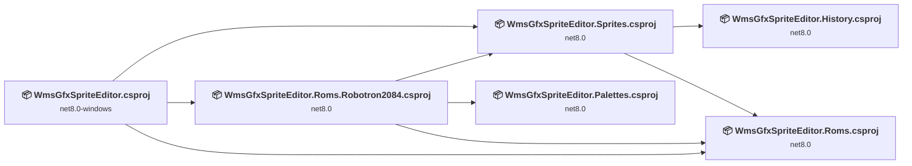
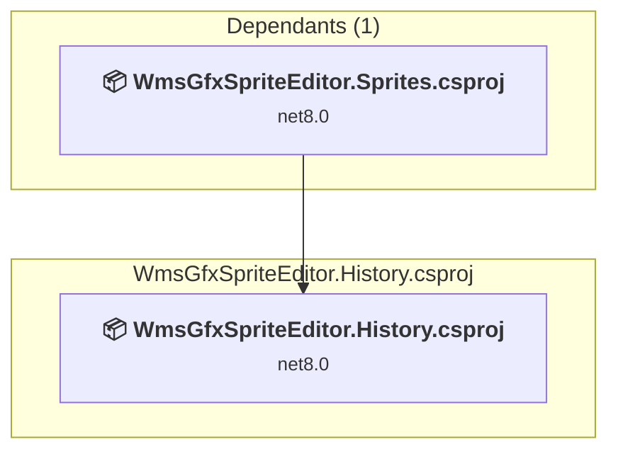
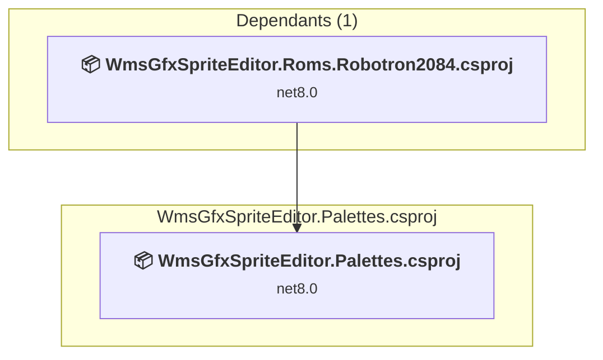
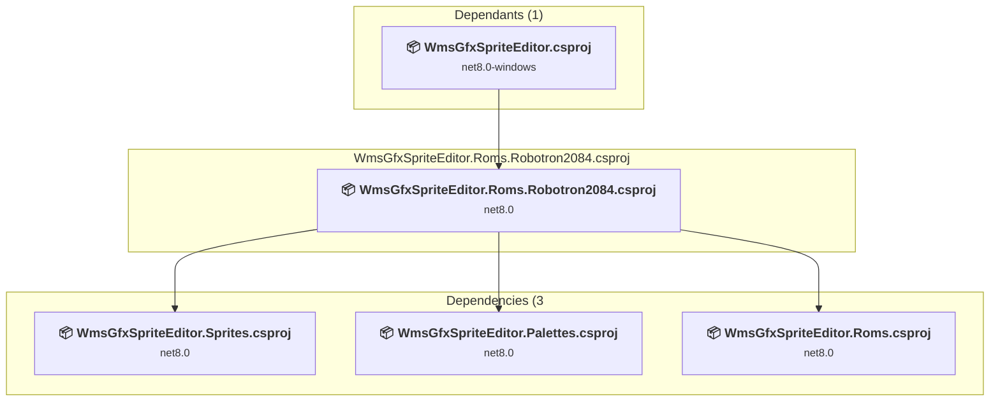
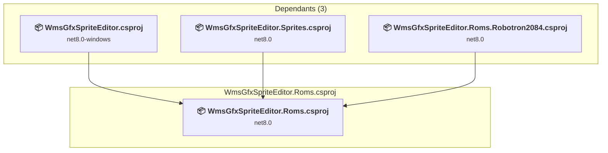
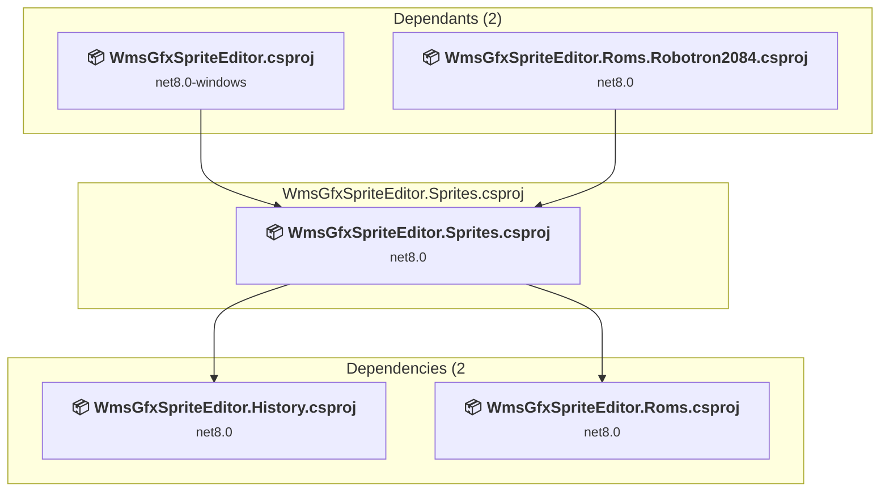
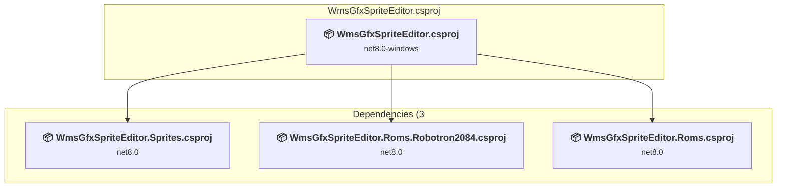

# Projects and dependencies analysis

This document provides a comprehensive overview of the projects and their dependencies in the context of upgrading to .NETCoreApp,Version=v10.0.

## Table of Contents

- [Executive Summary](#executive-Summary)
  - [Highlevel Metrics](#highlevel-metrics)
  - [Projects Compatibility](#projects-compatibility)
  - [Package Compatibility](#package-compatibility)
  - [API Compatibility](#api-compatibility)
  - [Binding Redirect Configuration](#binding-redirect-configuration)
- [Aggregate NuGet packages details](#aggregate-nuget-packages-details)
- [Top API Migration Challenges](#top-api-migration-challenges)
  - [Technologies and Features](#technologies-and-features)
  - [Most Frequent API Issues](#most-frequent-api-issues)
- [Projects Relationship Graph](#projects-relationship-graph)
- [Project Details](#project-details)

  - [WmsGfxSpriteEditor.History\WmsGfxSpriteEditor.History.csproj](#wmsgfxspriteeditorhistorywmsgfxspriteeditorhistorycsproj)
  - [WmsGfxSpriteEditor.Palettes\WmsGfxSpriteEditor.Palettes.csproj](#wmsgfxspriteeditorpaletteswmsgfxspriteeditorpalettescsproj)
  - [WmsGfxSpriteEditor.Roms.Robotron2084\WmsGfxSpriteEditor.Roms.Robotron2084.csproj](#wmsgfxspriteeditorromsrobotron2084wmsgfxspriteeditorromsrobotron2084csproj)
  - [WmsGfxSpriteEditor.Roms\WmsGfxSpriteEditor.Roms.csproj](#wmsgfxspriteeditorromswmsgfxspriteeditorromscsproj)
  - [WmsGfxSpriteEditor.Sprites\WmsGfxSpriteEditor.Sprites.csproj](#wmsgfxspriteeditorspriteswmsgfxspriteeditorspritescsproj)
  - [WmsGfxSpriteEditor\WmsGfxSpriteEditor.csproj](#wmsgfxspriteeditorwmsgfxspriteeditorcsproj)

## Executive Summary

### Highlevel Metrics

| Metric | Count | Status |
| :--- | :---: | :--- |
| Total Projects | 6 | All require upgrade |
| Total NuGet Packages | 3 | 1 need upgrade |
| Total Code Files | 59 |  |
| Total Code Files with Incidents | 29 |  |
| Total Lines of Code | 5396 |  |
| Total Number of Issues | 2033 |  |
| Estimated LOC to modify | 2026+ | at least 37.5% of codebase |

### Projects Compatibility

| Project | Target Framework | Difficulty | Package Issues | API Issues | Binding Issues | Est. LOC Impact | Description |
| :--- | :---: | :---: | :---: | :---: | :---: | :---: | :--- |
| [WmsGfxSpriteEditor.History\WmsGfxSpriteEditor.History.csproj](#wmsgfxspriteeditorhistorywmsgfxspriteeditorhistorycsproj) | net8.0 | 🟢 Low | 0 | 0 | 0 |  | ClassLibrary, Sdk Style = True |
| [WmsGfxSpriteEditor.Palettes\WmsGfxSpriteEditor.Palettes.csproj](#wmsgfxspriteeditorpaletteswmsgfxspriteeditorpalettescsproj) | net8.0 | 🟢 Low | 0 | 0 | 0 |  | ClassLibrary, Sdk Style = True |
| [WmsGfxSpriteEditor.Roms.Robotron2084\WmsGfxSpriteEditor.Roms.Robotron2084.csproj](#wmsgfxspriteeditorromsrobotron2084wmsgfxspriteeditorromsrobotron2084csproj) | net8.0 | 🟢 Low | 0 | 0 | 0 |  | ClassLibrary, Sdk Style = True |
| [WmsGfxSpriteEditor.Roms\WmsGfxSpriteEditor.Roms.csproj](#wmsgfxspriteeditorromswmsgfxspriteeditorromscsproj) | net8.0 | 🟢 Low | 0 | 0 | 0 |  | ClassLibrary, Sdk Style = True |
| [WmsGfxSpriteEditor.Sprites\WmsGfxSpriteEditor.Sprites.csproj](#wmsgfxspriteeditorspriteswmsgfxspriteeditorspritescsproj) | net8.0 | 🟢 Low | 1 | 9 | 0 | 9+ | ClassLibrary, Sdk Style = True |
| [WmsGfxSpriteEditor\WmsGfxSpriteEditor.csproj](#wmsgfxspriteeditorwmsgfxspriteeditorcsproj) | net8.0-windows | 🟡 Medium | 0 | 2017 | 0 | 2017+ | WinForms, Sdk Style = True |

### Package Compatibility

| Status | Count | Percentage |
| :--- | :---: | :---: |
| ✅ Compatible | 2 | 66.7% |
| ⚠️ Incompatible | 0 | 0.0% |
| 🔄 Upgrade Recommended | 1 | 33.3% |
| ***Total NuGet Packages*** | ***3*** | ***100%*** |

### API Compatibility

| Category | Count | Impact |
| :--- | :---: | :--- |
| 🔴 Binary Incompatible | 1947 | High - Require code changes |
| 🟡 Source Incompatible | 79 | Medium - Needs re-compilation and potential conflicting API error fixing |
| 🔵 Behavioral change | 0 | Low - Behavioral changes that may require testing at runtime |
| ✅ Compatible | 4133 |  |
| ***Total APIs Analyzed*** | ***6159*** |  |

## Aggregate NuGet packages details

| Package | Current Version | Suggested Version | Projects | Description |
| :--- | :---: | :---: | :--- | :--- |
| Microsoft.Win32.SystemEvents | 8.0.0 |  | [WmsGfxSpriteEditor.csproj](#wmsgfxspriteeditorwmsgfxspriteeditorcsproj) [WmsGfxSpriteEditor.Roms.Robotron2084.csproj](#wmsgfxspriteeditorromsrobotron2084wmsgfxspriteeditorromsrobotron2084csproj) [WmsGfxSpriteEditor.Sprites.csproj](#wmsgfxspriteeditorspriteswmsgfxspriteeditorspritescsproj) | ✅Compatible |
| StyleCop.Analyzers | 1.1.118 |  | [WmsGfxSpriteEditor.csproj](#wmsgfxspriteeditorwmsgfxspriteeditorcsproj) [WmsGfxSpriteEditor.History.csproj](#wmsgfxspriteeditorhistorywmsgfxspriteeditorhistorycsproj) [WmsGfxSpriteEditor.Palettes.csproj](#wmsgfxspriteeditorpaletteswmsgfxspriteeditorpalettescsproj) [WmsGfxSpriteEditor.Roms.csproj](#wmsgfxspriteeditorromswmsgfxspriteeditorromscsproj) [WmsGfxSpriteEditor.Roms.Robotron2084.csproj](#wmsgfxspriteeditorromsrobotron2084wmsgfxspriteeditorromsrobotron2084csproj) [WmsGfxSpriteEditor.Sprites.csproj](#wmsgfxspriteeditorspriteswmsgfxspriteeditorspritescsproj) | ✅Compatible |
| System.Drawing.Common | 8.0.17 | 10.0.12 | [WmsGfxSpriteEditor.csproj](#wmsgfxspriteeditorwmsgfxspriteeditorcsproj) [WmsGfxSpriteEditor.Roms.Robotron2084.csproj](#wmsgfxspriteeditorromsrobotron2084wmsgfxspriteeditorromsrobotron2084csproj) [WmsGfxSpriteEditor.Sprites.csproj](#wmsgfxspriteeditorspriteswmsgfxspriteeditorspritescsproj) | NuGet package upgrade is recommended |

## Top API Migration Challenges

### Technologies and Features

| Technology | Issues | Percentage | Migration Path |
| :--- | :---: | :---: | :--- |
| Windows Forms | 1947 | 96.1% | Windows Forms APIs for building Windows desktop applications with traditional Forms-based UI that are available in .NET on Windows. Enable Windows Desktop support: Option 1 (Recommended): Target net9.0-windows; Option 2: Add <UseWindowsDesktop>true</UseWindowsDesktop>; Option 3 (Legacy): Use Microsoft.NET.Sdk.WindowsDesktop SDK. |
| GDI+ / System.Drawing | 79 | 3.9% | System.Drawing APIs for 2D graphics, imaging, and printing that are available via NuGet package System.Drawing.Common. Note: Not recommended for server scenarios due to Windows dependencies; consider cross-platform alternatives like SkiaSharp or ImageSharp for new code. |

### Most Frequent API Issues

| API | Count | Percentage | Category |
| :--- | :---: | :---: | :--- |
| T:System.Windows.Forms.ToolStripMenuItem | 381 | 18.8% | Binary Incompatible |
| T:System.Windows.Forms.Keys | 162 | 8.0% | Binary Incompatible |
| P:System.Windows.Forms.ToolStripMenuItem.Enabled | 55 | 2.7% | Binary Incompatible |
| P:System.Windows.Forms.ToolStripItem.Name | 49 | 2.4% | Binary Incompatible |
| P:System.Windows.Forms.ToolStripItem.Size | 48 | 2.4% | Binary Incompatible |
| P:System.Windows.Forms.ToolStripItem.Text | 44 | 2.2% | Binary Incompatible |
| T:System.Windows.Forms.ToolStripButton | 44 | 2.2% | Binary Incompatible |
| T:System.Windows.Forms.ToolStripStatusLabel | 38 | 1.9% | Binary Incompatible |
| M:System.Windows.Forms.ToolStripMenuItem.#ctor | 36 | 1.8% | Binary Incompatible |
| E:System.Windows.Forms.ToolStripItem.Click | 30 | 1.5% | Binary Incompatible |
| T:System.Windows.Forms.ToolStripSeparator | 30 | 1.5% | Binary Incompatible |
| P:System.Windows.Forms.ToolStripMenuItem.ShortcutKeys | 29 | 1.4% | Binary Incompatible |
| T:System.Windows.Forms.TrackBar | 27 | 1.3% | Binary Incompatible |
| F:System.Windows.Forms.Keys.Control | 24 | 1.2% | Binary Incompatible |
| T:System.Windows.Forms.TableLayoutPanel | 24 | 1.2% | Binary Incompatible |
| T:System.Windows.Forms.ComboBox | 23 | 1.1% | Binary Incompatible |
| P:System.Windows.Forms.Control.Size | 20 | 1.0% | Binary Incompatible |
| T:System.Windows.Forms.MouseButtons | 19 | 0.9% | Binary Incompatible |
| T:System.Windows.Forms.ToolStripItemCollection | 18 | 0.9% | Binary Incompatible |
| T:System.Windows.Forms.AnchorStyles | 18 | 0.9% | Binary Incompatible |
| T:System.Windows.Forms.PictureBox | 18 | 0.9% | Binary Incompatible |
| T:System.Windows.Forms.ContextMenuStrip | 15 | 0.7% | Binary Incompatible |
| T:System.Windows.Forms.ToolStrip | 15 | 0.7% | Binary Incompatible |
| T:System.Windows.Forms.MenuStrip | 15 | 0.7% | Binary Incompatible |
| T:System.Windows.Forms.DockStyle | 15 | 0.7% | Binary Incompatible |
| P:System.Windows.Forms.Control.Name | 14 | 0.7% | Binary Incompatible |
| T:System.Windows.Forms.Panel | 14 | 0.7% | Binary Incompatible |
| P:System.Windows.Forms.ToolStripItem.Enabled | 14 | 0.7% | Binary Incompatible |
| T:System.Windows.Forms.DialogResult | 13 | 0.6% | Binary Incompatible |
| M:System.Windows.Forms.ToolStripItemCollection.AddRange(System.Windows.Forms.ToolStripItem[]) | 13 | 0.6% | Binary Incompatible |
| T:System.Drawing.Graphics | 13 | 0.6% | Source Incompatible |
| T:System.Windows.Forms.Label | 13 | 0.6% | Binary Incompatible |
| T:System.Windows.Forms.StatusStrip | 13 | 0.6% | Binary Incompatible |
| P:System.Windows.Forms.ToolStripDropDownItem.DropDownItems | 13 | 0.6% | Binary Incompatible |
| P:System.Windows.Forms.Control.Location | 12 | 0.6% | Binary Incompatible |
| T:System.Windows.Forms.Cursor | 12 | 0.6% | Binary Incompatible |
| M:System.Windows.Forms.Control.Invalidate | 11 | 0.5% | Binary Incompatible |
| T:System.Windows.Forms.MouseEventHandler | 11 | 0.5% | Binary Incompatible |
| T:System.Windows.Forms.TickStyle | 11 | 0.5% | Binary Incompatible |
| T:System.Windows.Forms.MessageBoxIcon | 10 | 0.5% | Binary Incompatible |
| T:System.Windows.Forms.MessageBoxButtons | 10 | 0.5% | Binary Incompatible |
| P:System.Windows.Forms.Control.TabIndex | 10 | 0.5% | Binary Incompatible |
| M:System.Windows.Forms.Control.ResumeLayout(System.Boolean) | 9 | 0.4% | Binary Incompatible |
| M:System.Windows.Forms.Control.SuspendLayout | 9 | 0.4% | Binary Incompatible |
| T:System.Windows.Forms.MouseEventArgs | 9 | 0.4% | Binary Incompatible |
| T:System.Windows.Forms.ToolStripItemAlignment | 9 | 0.4% | Binary Incompatible |
| T:System.Windows.Forms.Control.ControlCollection | 8 | 0.4% | Binary Incompatible |
| P:System.Windows.Forms.Control.Controls | 8 | 0.4% | Binary Incompatible |
| M:System.Windows.Forms.Control.ControlCollection.Add(System.Windows.Forms.Control) | 8 | 0.4% | Binary Incompatible |
| F:System.Windows.Forms.Keys.Shift | 8 | 0.4% | Binary Incompatible |

## Projects Relationship Graph

Legend:
📦 SDK-style project
⚙️ Classic project

## Project Details

### WmsGfxSpriteEditor.History\WmsGfxSpriteEditor.History.csproj

#### Project Info

- **Current Target Framework:** net8.0
- **Proposed Target Framework:** net10.0
- **SDK-style**: True
- **Project Kind:** ClassLibrary
- **Dependencies**: 0
- **Dependants**: 1
- **Number of Files**: 3
- **Number of Files with Incidents**: 1
- **Lines of Code**: 209
- **Estimated LOC to modify**: 0+ (at least 0.0% of the project)

#### Dependency Graph

Legend:
📦 SDK-style project
⚙️ Classic project

### API Compatibility

| Category | Count | Impact |
| :--- | :---: | :--- |
| 🔴 Binary Incompatible | 0 | High - Require code changes |
| 🟡 Source Incompatible | 0 | Medium - Needs re-compilation and potential conflicting API error fixing |
| 🔵 Behavioral change | 0 | Low - Behavioral changes that may require testing at runtime |
| ✅ Compatible | 151 |  |
| ***Total APIs Analyzed*** | ***151*** |  |

### WmsGfxSpriteEditor.Palettes\WmsGfxSpriteEditor.Palettes.csproj

#### Project Info

- **Current Target Framework:** net8.0
- **Proposed Target Framework:** net10.0
- **SDK-style**: True
- **Project Kind:** ClassLibrary
- **Dependencies**: 0
- **Dependants**: 1
- **Number of Files**: 1
- **Number of Files with Incidents**: 1
- **Lines of Code**: 16
- **Estimated LOC to modify**: 0+ (at least 0.0% of the project)

#### Dependency Graph

Legend:
📦 SDK-style project
⚙️ Classic project

### API Compatibility

| Category | Count | Impact |
| :--- | :---: | :--- |
| 🔴 Binary Incompatible | 0 | High - Require code changes |
| 🟡 Source Incompatible | 0 | Medium - Needs re-compilation and potential conflicting API error fixing |
| 🔵 Behavioral change | 0 | Low - Behavioral changes that may require testing at runtime |
| ✅ Compatible | 0 |  |
| ***Total APIs Analyzed*** | ***0*** |  |

### WmsGfxSpriteEditor.Roms.Robotron2084\WmsGfxSpriteEditor.Roms.Robotron2084.csproj

#### Project Info

- **Current Target Framework:** net8.0
- **Proposed Target Framework:** net10.0
- **SDK-style**: True
- **Project Kind:** ClassLibrary
- **Dependencies**: 3
- **Dependants**: 1
- **Number of Files**: 8
- **Number of Files with Incidents**: 1
- **Lines of Code**: 541
- **Estimated LOC to modify**: 0+ (at least 0.0% of the project)

#### Dependency Graph

Legend:
📦 SDK-style project
⚙️ Classic project

### API Compatibility

| Category | Count | Impact |
| :--- | :---: | :--- |
| 🔴 Binary Incompatible | 0 | High - Require code changes |
| 🟡 Source Incompatible | 0 | Medium - Needs re-compilation and potential conflicting API error fixing |
| 🔵 Behavioral change | 0 | Low - Behavioral changes that may require testing at runtime |
| ✅ Compatible | 973 |  |
| ***Total APIs Analyzed*** | ***973*** |  |

### WmsGfxSpriteEditor.Roms\WmsGfxSpriteEditor.Roms.csproj

#### Project Info

- **Current Target Framework:** net8.0
- **Proposed Target Framework:** net10.0
- **SDK-style**: True
- **Project Kind:** ClassLibrary
- **Dependencies**: 0
- **Dependants**: 3
- **Number of Files**: 6
- **Number of Files with Incidents**: 1
- **Lines of Code**: 259
- **Estimated LOC to modify**: 0+ (at least 0.0% of the project)

#### Dependency Graph

Legend:
📦 SDK-style project
⚙️ Classic project

### API Compatibility

| Category | Count | Impact |
| :--- | :---: | :--- |
| 🔴 Binary Incompatible | 0 | High - Require code changes |
| 🟡 Source Incompatible | 0 | Medium - Needs re-compilation and potential conflicting API error fixing |
| 🔵 Behavioral change | 0 | Low - Behavioral changes that may require testing at runtime |
| ✅ Compatible | 210 |  |
| ***Total APIs Analyzed*** | ***210*** |  |

### WmsGfxSpriteEditor.Sprites\WmsGfxSpriteEditor.Sprites.csproj

#### Project Info

- **Current Target Framework:** net8.0
- **Proposed Target Framework:** net10.0
- **SDK-style**: True
- **Project Kind:** ClassLibrary
- **Dependencies**: 2
- **Dependants**: 2
- **Number of Files**: 8
- **Number of Files with Incidents**: 4
- **Lines of Code**: 639
- **Estimated LOC to modify**: 9+ (at least 1.4% of the project)

#### Dependency Graph

Legend:
📦 SDK-style project
⚙️ Classic project

### API Compatibility

| Category | Count | Impact |
| :--- | :---: | :--- |
| 🔴 Binary Incompatible | 0 | High - Require code changes |
| 🟡 Source Incompatible | 9 | Medium - Needs re-compilation and potential conflicting API error fixing |
| 🔵 Behavioral change | 0 | Low - Behavioral changes that may require testing at runtime |
| ✅ Compatible | 377 |  |
| ***Total APIs Analyzed*** | ***386*** |  |

#### Project Technologies and Features

| Technology | Issues | Percentage | Migration Path |
| :--- | :---: | :---: | :--- |
| GDI+ / System.Drawing | 9 | 100.0% | System.Drawing APIs for 2D graphics, imaging, and printing that are available via NuGet package System.Drawing.Common. Note: Not recommended for server scenarios due to Windows dependencies; consider cross-platform alternatives like SkiaSharp or ImageSharp for new code. |

### WmsGfxSpriteEditor\WmsGfxSpriteEditor.csproj

#### Project Info

- **Current Target Framework:** net8.0-windows
- **Proposed Target Framework:** net10.0-windows
- **SDK-style**: True
- **Project Kind:** WinForms
- **Dependencies**: 3
- **Dependants**: 0
- **Number of Files**: 37
- **Number of Files with Incidents**: 21
- **Lines of Code**: 3732
- **Estimated LOC to modify**: 2017+ (at least 54.0% of the project)

#### Dependency Graph

Legend:
📦 SDK-style project
⚙️ Classic project

### API Compatibility

| Category | Count | Impact |
| :--- | :---: | :--- |
| 🔴 Binary Incompatible | 1947 | High - Require code changes |
| 🟡 Source Incompatible | 70 | Medium - Needs re-compilation and potential conflicting API error fixing |
| 🔵 Behavioral change | 0 | Low - Behavioral changes that may require testing at runtime |
| ✅ Compatible | 2422 |  |
| ***Total APIs Analyzed*** | ***4439*** |  |

#### Project Technologies and Features

| Technology | Issues | Percentage | Migration Path |
| :--- | :---: | :---: | :--- |
| Windows Forms | 1947 | 96.5% | Windows Forms APIs for building Windows desktop applications with traditional Forms-based UI that are available in .NET on Windows. Enable Windows Desktop support: Option 1 (Recommended): Target net9.0-windows; Option 2: Add <UseWindowsDesktop>true</UseWindowsDesktop>; Option 3 (Legacy): Use Microsoft.NET.Sdk.WindowsDesktop SDK. |
| GDI+ / System.Drawing | 70 | 3.5% | System.Drawing APIs for 2D graphics, imaging, and printing that are available via NuGet package System.Drawing.Common. Note: Not recommended for server scenarios due to Windows dependencies; consider cross-platform alternatives like SkiaSharp or ImageSharp for new code. |

